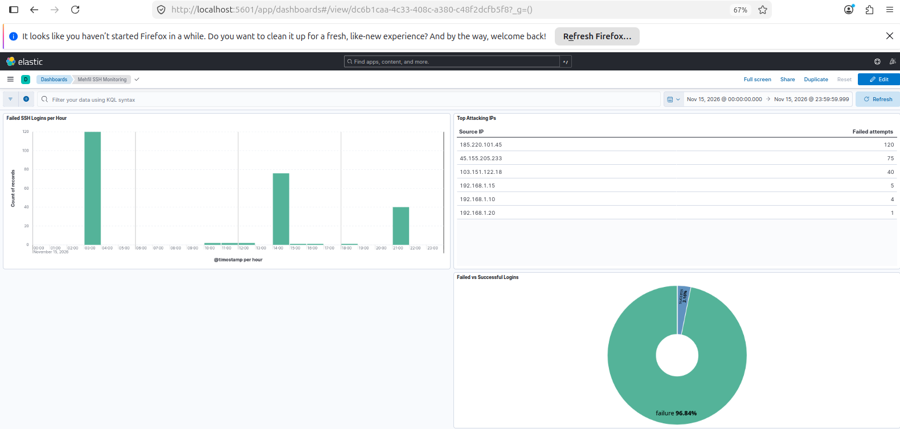

# SOC Log Analysis and Detection Pipeline: Mehfil Event Planners (Task 1)

Log aggregation and initial threat identification for Mehfil Event Planners' booking server.
A local ELK stack ingests a synthetic 24-hour SSH `auth.log`, and a Kibana dashboard
shows brute-force spikes. Top attacking IPs are extracted with `grep` and `awk`.

## Architecture

```
generate_auth_log.py -> logs/auth.log -> Logstash (grok) -> Elasticsearch -> Kibana
```

## Repository structure

```
.
├── docker-compose.yml
├── logstash/pipeline/logstash.conf
├── scripts/generate_auth_log.py
├── logs/auth.log
├── findings/top_3_attacking_ips.txt
├── findings/findings.md
└── screenshots/
```

## Setup

Requirements: Ubuntu, Docker, Docker Compose, about 4 GB free RAM.

```bash
echo "vm.max_map_count=262144" | sudo tee /etc/sysctl.d/99-elk.conf
sudo sysctl --system

docker compose up -d elasticsearch kibana
python3 scripts/generate_auth_log.py
docker compose up -d logstash
```

- Elasticsearch: http://localhost:9201
- Kibana: http://localhost:5601

> Note: Elasticsearch is mapped to host port **9201** (not 9200) because a Wazuh Indexer
> was already running on 9200 on my machine. Inside Docker, Logstash and Kibana still
> use `elasticsearch:9200`.
>
> Security (`xpack.security`) is disabled for this local lab only. Do not do this on a real server.

## Synthetic log

`scripts/generate_auth_log.py` generates 253 SSH log lines for 15 Nov 2026:

| Type | Count |
|---|---|
| Failed logins | 245 |
| Successful logins | 8 |

Attack patterns:
- 185.220.101.45: 120 failed attempts around 03:20, then a successful login as `admin`
- 45.155.205.233: 75 failed attempts around 14:00
- 103.151.122.18: 40 failed attempts around 21:00
- Staff IPs (192.168.1.x): normal logins and a few typos

## Ingestion (Logstash)

`logstash/pipeline/logstash.conf` reads `/logs/auth.log`, uses grok to extract
`src_ip`, `user`, `src_port` and `pid`, sets `@timestamp` from the log time
(Asia/Karachi), and adds `outcome` (`failure` / `success`).

Data goes to `ssh-auth-YYYY.MM.dd`. Index names use UTC dates, so entries before 05:00 PKT
land in `ssh-auth-2026.11.14` (121 docs) and the rest in `ssh-auth-2026.11.15` (132 docs).
Total: 253. Index health is yellow because a single node cannot hold replicas.

## CLI analysis (grep + awk)

```bash
grep "Failed password" logs/auth.log \
 | awk '{for(i=1;i<=NF;i++) if($i=="from") print $(i+1)}' \
 | sort | uniq -c | sort -nr | head -3
```

| Rank | IP | Failed attempts |
|---|---|---|
| 1 | 185.220.101.45 | 120 |
| 2 | 45.155.205.233 | 75 |
| 3 | 103.151.122.18 | 40 |

Awk looks for the word `from` and prints the next word, because `invalid user` lines shift
the column positions.

Key finding: 185.220.101.45 later logged in successfully as `admin`
(`grep "Accepted password" logs/auth.log | grep 185.220.101.45`), which suggests a
possible compromise. This will be handled in the incident response playbook (Task 3).

## Kibana dashboard: "Mehfil SSH Monitoring"

- Failed SSH Logins per Hour (spikes at 03:00, 14:00, 21:00)
- Top Attacking IPs
- Failed vs Successful Logins (96.84% / 3.16%)

| | |
|---|---|
| Elasticsearch running | `screenshots/01-elasticsearch-running.png` |
| Kibana home | `screenshots/02-kibana-home.png` |
| Index Management | `screenshots/03-index-management.png` |
| Discover | `screenshots/04-discover-spike.png` |
| Dashboard | `screenshots/05-dashboard.png` |



## Next steps

- Task 2: detection rules for brute-force attempts
- Task 3: incident response playbook and handover
